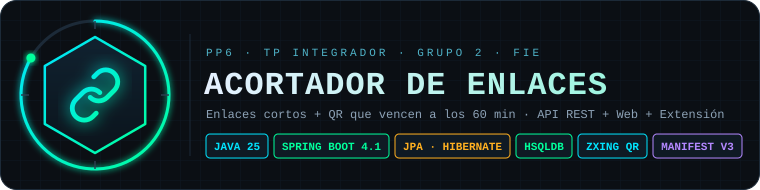
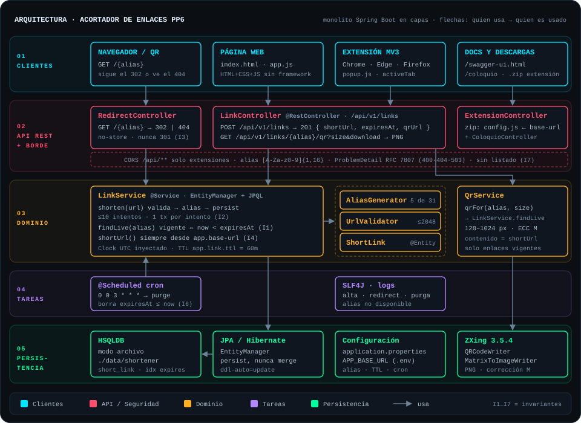

<p align="center"></p>

# 🔗 PP6-TPGrupo2 – Acortador de enlaces (Link Shortener)

**Servicio web monolítico en capas (Spring Boot + JPA) con API REST, cliente web y extensión de navegador**

> **Pegás una dirección larga y obtenés un enlace corto y su código QR, válidos por 60 minutos.**

Trabajo Práctico Integrador – **Paradigmas de Programación VI** – Etapa 1
**Cátedra:** FIE – 5to Año – Ingeniería en Informática
**Equipo:** Martín Crespo · Sofía Ramirez · Agustín Gimenez

## Descripción

Las direcciones largas son incómodas de compartir, dictar o imprimir. Este sistema las reemplaza por un **alias de 5 caracteres** (`http://host/k7mzq`) y genera el **QR** de esa URL corta. Cada enlace **vence a los 60 minutos**: a partir de ahí responde "Este enlace expiró o no existe" y su alias puede volver a asignarse.

El alcance de la Etapa 1 está fijado por la consigna ([`TP_PP6_v1.0.md`](TP_PP6_v1.0.md)) y las respuestas del cliente registradas en [`contexto.md`](contexto.md): sin cuentas de usuario, sin estadísticas, sin alias personalizados y sin listado de enlaces. El diseño deja preparados los puntos de extensión para los cambios de las Etapas 2 y 3 (`contexto.md` §14).

Hay dos clientes, la **página web** y la **extensión para Chrome y Firefox**, y los dos usan la misma API.

> ℹ️ **Estado:** Etapa 1 **finalizada** y lista para entregar. La suite tiene **101 métodos de test** (91 `@Test` + 10 `@ParameterizedTest`) entre unitarios, de integración contra HSQLDB y de los archivos estáticos. `gradlew check` **falla si la cobertura de líneas de `app.mappings` + `app.service` baja del 70 %**. El despliegue en un VPS queda fuera de la Etapa 1.

## Features

| Feature / Módulo | Descripción Técnica | Estado |
| :--- | :--- | :---: |
| Acortar URL | `POST /api/v1/links` valida la URL, genera el alias y persiste con `EntityManager.persist`; responde `201` con `shortUrl`, `expiresAt`, `secondsRemaining` y `qrUrl` | ✅ |
| Redirección | `GET /{alias}` → `302` mientras está vigente, `404` con página HTML si venció o no existe. Nunca `301`, siempre `Cache-Control: no-store` | ✅ |
| Vencimiento a 60 min | `ShortLink.isExpired(now)` sobre el intervalo `[createdAt, expiresAt)`, evaluado en **cada lectura**; no depende del cron | ✅ |
| Código QR | `GET /api/v1/links/{alias}/qr?size=256&download=false`: PNG de 128 a 1024 px (ZXing, corrección M); con `download=true` baja como `{alias}.png` | ✅ |
| Generación de alias | 5 caracteres con `SecureRandom` sobre 31 símbolos sin ambiguos (`0 o 1 l i`), salteando palabras reservadas | ✅ |
| Colisiones y concurrencia | Alias como PK, un intento por transacción (`TransactionTemplate`), hasta 10 reintentos; si se agotan, `503` + `Retry-After: 1` | ✅ |
| Validación de URL | Solo `http`/`https` absolutas con host, hasta 2048 caracteres; mensajes aptos para el usuario | ✅ |
| Errores de la API | `ProblemDetail` (RFC 7807) para `400`, `404` y `503`, acotado a `LinkController` | ✅ |
| Limpieza de vencidos | `@Scheduled` diario a las 03:00: `DELETE … WHERE expiresAt <= now` | ✅ |
| Persistencia | HSQLDB en modo archivo (`./data/`): los enlaces sobreviven a un reinicio | ✅ |
| Cliente web | `index.html` + `app.js` sin framework, servido por el mismo backend | ✅ |
| Extensión MV3 | Chrome, Edge y Firefox con el mismo código; acorta la pestaña activa | ✅ |
| Descarga de la extensión | `/descargas/acortador-pp6.zip` con `config.js` reescrito para el servidor que la entrega | ✅ |
| Documentación viva | Swagger UI (`/swagger-ui.html`) y guía del código con diagrama de clases (`/coloquio`) | ✅ |
| Despliegue en VPS | Solo requiere `APP_BASE_URL`; fuera del alcance de la Etapa 1 | ⏳ |

## Arquitectura

<p align="center"></p>

Recorrido de un pedido, de punta a punta:

```text
 ┌──────────────┐  POST /api/v1/links {url}   ┌────────────────┐   shorten(url)   ┌──────────────────────────┐
 │ Web / Ext.   │ ──────────────────────────▶ │ LinkController │ ───────────────▶ │ LinkService              │
 └──────────────┘ ◀── 201 {shortUrl, qrUrl} ─ └────────────────┘                  │  1. UrlValidator.validate│
                                                                                  │  2. AliasGenerator ×≤10  │
                                                                                  │  3. tx: find → persist   │
                                                                                  └────────────┬─────────────┘
                                                                                               │ JPA
 ┌──────────────┐  GET /{alias}               ┌────────────────────┐  resolve()   ┌────────────▼─────────────┐
 │ Navegador /  │ ──────────────────────────▶ │ RedirectController │ ───────────▶ │ HSQLDB  short_link       │
 │ cámara QR    │ ◀── 302 Location | 404 ──── └────────────────────┘ findLive()   │ PK alias · idx expires_at│
 └──────────────┘                              now < expiresAt ? 302 : 404        └──────────────────────────┘
                                                                                               ▲
 ┌──────────────┐  @Scheduled 0 0 3 * * *     ┌────────────────────────────────────────────────┘
 │ Scheduler    │ ──── purgeExpired(): DELETE WHERE expiresAt <= now (solo libera espacio)
 └──────────────┘
```

**Principios y patrones aplicados**

- **Monolito en capas** con la estructura de paquetes del proyecto de referencia de la cátedra: `controller → service → mappings`, sin `Repository` ni DAO. Cada `@Service` es dueño de sus consultas (JPQL sobre `EntityManager`).
- **Reglas en la capa más baja posible:** la vigencia vive en la entidad (`ShortLink.isExpired`) y el servicio la aplica en cada lectura (`findLive`), así redirect y QR comparten la misma regla.
- **Fallar cerrado:** ante la duda no se redirige. La limpieza programada solo libera espacio; que un vencido no redirija no depende de ella.
- **Inyección de dependencias y reloj inyectable:** `Clock` UTC como bean, reemplazado en los tests por `MutableClock` para probar vencimientos sin esperar.
- **Configuración externa:** TTL, alfabeto, largo, palabras reservadas, cron y dominio salen de `application.properties` y se sobrescriben por variables de entorno.
- **Transacción por intento:** `shorten` no es `@Transactional` a propósito. Tras una violación de PK la sesión de Hibernate queda inutilizable, así que cada intento corre en su propia transacción.
- **Controller Advice:** `GlobalExceptionHandler` traduce las excepciones de negocio a `ProblemDetail` solo para la API; el redirect y las páginas siguen respondiendo HTML.
- **DTO como `record`:** `ShortenRequest` y `ShortLinkResponse` separan el contrato JSON de la entidad JPA.

El diagrama de clases completo, en Mermaid, y la versión interactiva están en [`/coloquio`](https://paradigmas6.agustingimenez.ar/coloquio) (con la app levantada, http://localhost:8080/coloquio).

## Actores e invariantes del dominio

No hay autenticación: la API es pública por diseño y lo que la protege es que **no expone nada sin conocer el alias**.

| Actor | Puede | No puede |
| :--- | :--- | :--- |
| Usuario de la web o de la extensión | Acortar una URL http/https, ver, copiar y descargar el QR | Elegir el alias, cambiar el TTL, listar o borrar enlaces |
| Visitante de un enlace corto | Seguir el enlace o escanear el QR mientras está vigente | Llegar al destino después de vencido |
| Operador (despliegue) | Configurar dominio, TTL, alias y cron por propiedades o entorno | Cambiar el comportamiento sin reiniciar |

Las **invariantes** son reglas cuyo incumplimiento es un incidente, no un bug menor. Cada una tiene un test que la rompe a propósito (`contexto.md` §7 y §15.4).

| ID | Invariante | Dónde se sostiene |
| :---: | :--- | :--- |
| **I1** | Un enlace **nunca redirige si `now ≥ expiresAt`**, haya corrido o no el cron | `ShortLink.isExpired` evaluado en `LinkService.findLive` |
| **I2** | **Como máximo un enlace por alias**, incluso con pedidos simultáneos; nunca se sobrescribe uno vigente | Alias como PK + `persist` (nunca `merge`) + reintento ante la violación de la PK |
| **I3** | La redirección **nunca es un 301** | `RedirectController` |
| **I4** | La `shortUrl` y el QR se arman **siempre desde `app.base-url`**, nunca desde los headers | `LinkService.shortUrl` (lo usan la creación y `QrService`) |
| **I5** | **Ningún secreto en el repositorio** | Variables de entorno + `.gitignore` |
| **I6** | **El cron nunca borra un enlace vigente** | JPQL de `LinkService.purgeExpired` con `expiresAt <= now` |
| **I7** | **Ningún endpoint lista enlaces** ni devuelve un destino sin conocer su alias | Contrato de la API |

Límite documentado de I1: depende del reloj del servidor; tenerlo sincronizado (NTP) es requisito de despliegue.

### Contrato de la API

| Endpoint | Respuesta |
| :--- | :--- |
| `POST /api/v1/links` con `{"url": "..."}` | `201` con `shortUrl`, `expiresAt`, `secondsRemaining` y `qrUrl` · `400` URL inválida o JSON mal formado · `503` sin alias libres |
| `GET /{alias}` | `302` a la URL original mientras está vigente · `404` (página HTML) si venció o no existe |
| `GET /api/v1/links/{alias}/qr?size=256&download=false` | PNG de 128 a 1024 px · `400` tamaño fuera de rango · `404` enlace no disponible |

## Estructura del repositorio

```text
Trabajo PP6 Aplicacion/
├── assets/                        logo y diagrama de arquitectura de este README (SVG)
├── browser-extension/             extensión Manifest V3 (Chrome, Edge y Firefox)
│   ├── manifest.json              permiso activeTab + host_permissions del servidor
│   ├── config.js                  apiBaseUrl: servidor al que llama la extensión
│   └── popup.html/.css/.js        interfaz del popup
├── gradle/wrapper/                Gradle 9.8.1 incluido: no hace falta instalarlo
├── scripts/
│   └── package-extension.ps1      zip de la extensión para otro servidor (-ApiUrl)
├── src/main/java/app/
│   ├── Application.java           arranque, Clock UTC, CORS para la extensión, @EnableScheduling
│   ├── controller/                LinkController, RedirectController, ExtensionController, ColoquioController
│   ├── dto/                       ShortenRequest y ShortLinkResponse (records)
│   ├── exception/                 errores de negocio y GlobalExceptionHandler → ProblemDetail
│   ├── mappings/                  entidad JPA ShortLink (tabla short_link)
│   └── service/                   LinkService, QrService, AliasGenerator, UrlValidator
├── src/main/resources/
│   ├── application.properties     toda la configuración (TTL, alias, cron, datasource)
│   └── static/                    página web, página 404 y guía /coloquio
├── src/test/java/app/             tests unitarios, de integración y de archivos estáticos
│   └── support/                   MutableClock, TestDb, QrDecoder, ScriptedAliasGenerator…
├── build.gradle                   dependencias, JaCoCo (umbral 70 %) y tarea extensionZip
├── .env.example                   variables de entorno para correr fuera de localhost
├── TP_PP6_v1.0.md                 consigna
├── contexto.md                    especificación, decisiones, invariantes y plan de pruebas
└── ANALISIS_Y_ESPECIFICACION_ETAPA_1.md   documento de análisis de la Etapa 1
```

## Puesta en marcha

**Requisitos:** un JDK cualquiera para arrancar el wrapper. El proyecto compila con **Java 25** por toolchain: si no está instalado, Gradle lo descarga la primera vez. No hace falta Docker ni una base externa: HSQLDB corre embebida.

| Acción | Windows | Linux / macOS |
| :--- | :--- | :--- |
| Levantar la aplicación | `.\gradlew.bat bootRun` | `./gradlew bootRun` |
| Compilar y correr los tests | `.\gradlew.bat build` | `./gradlew build` |
| Generar el JAR | `.\gradlew.bat bootJar` | `./gradlew bootJar` |
| Generar el zip de la extensión | `.\gradlew.bat extensionZip` | `./gradlew extensionZip` |

Con la aplicación levantada:

- Página web: http://localhost:8080
- Swagger UI: http://localhost:8080/swagger-ui.html
- Guía del código: http://localhost:8080/coloquio

La base se crea sola (`ddl-auto=update`) en `./data/`, ignorada por git; no hay migraciones ni seed. El JAR queda en `build/libs/shortener.jar`:

```bash
APP_BASE_URL=http://ip-o-dominio:8080 java -jar build/libs/shortener.jar
```

### Variables de entorno

Spring Boot mapea cualquier propiedad a una variable de entorno (`app.link.ttl` → `APP_LINK_TTL`). La única necesaria fuera de localhost es `APP_BASE_URL` (ver [`.env.example`](.env.example)).

| Variable | Propiedad | Default | Para qué |
| :--- | :--- | :--- | :--- |
| `APP_BASE_URL` | `app.base-url` | `http://localhost:8080` | Dominio con el que se arman la URL corta y el QR (I4) |
| `APP_LINK_TTL` | `app.link.ttl` | `60m` | Vida de cada enlace |
| `APP_CLEANUP_CRON` | `app.cleanup.cron` | `0 0 3 * * *` | Horario de la limpieza de vencidos |
| `SPRING_DATASOURCE_URL` | `spring.datasource.url` | `jdbc:hsqldb:file:./data/shortener;shutdown=true` | Ubicación de la base |
| `SERVER_PORT` | `server.port` | `8080` | Puerto HTTP |

Largo, alfabeto, palabras reservadas y reintentos del alias están en `app.alias.*` dentro de [`application.properties`](src/main/resources/application.properties).

### Extensión para Chrome y Firefox

La extensión usa el servidor de [`config.js`](browser-extension/config.js) (`http://localhost:8080`): **la aplicación tiene que estar levantada**. Con la app corriendo, la página web ofrece **Descargar la extensión**, un `.zip` ya configurado para el servidor del que se bajó.

**Chrome / Edge**
1. Abrir `chrome://extensions` (en Edge, `edge://extensions`).
2. Activar **Modo de desarrollador**.
3. **Cargar descomprimida** → elegir la carpeta `browser-extension`.
4. Fijarla con el ícono del rompecabezas.

**Firefox**
1. Abrir `about:debugging#/runtime/this-firefox`.
2. **Cargar complemento temporal…** → elegir `browser-extension/manifest.json` (o el `.zip`).
3. Firefox la quita al cerrarse: la extensión no está firmada.

En páginas que no son http/https (por ejemplo una pestaña nueva) el botón ACORTAR aparece deshabilitado con el aviso "Esta página no se puede acortar (solo http/https)". Para otro servidor sin tocar el repositorio:

```powershell
powershell -ExecutionPolicy Bypass -File scripts\package-extension.ps1 -ApiUrl https://paradigmas6.agustingimenez.ar
```

## Testing y calidad

| Acción | Comando (Windows; en Linux/macOS `./gradlew`) |
| :--- | :--- |
| Tests unitarios e integración | `.\gradlew.bat test` |
| Tests + verificación de cobertura (≥ 70 %) | `.\gradlew.bat check` |
| Subir el umbral de cobertura | `.\gradlew.bat check -PcoverageMinimum=0.90` |
| Una sola clase de test | `.\gradlew.bat test --tests app.service.LinkServiceTest` |
| Build completo (compila + tests + JAR) | `.\gradlew.bat build` |

- Reporte de cobertura JaCoCo: `build/reports/jacoco/test/html/index.html` (también en XML).
- Reporte de tests: `build/reports/tests/test/index.html`.
- El tipado lo verifica el compilador de Java 25; el proyecto **no tiene linter ni análisis estático** configurados.

Qué cubre la suite: validación de URL por partición de equivalencia y valores límite, generación de alias y palabras reservadas, vencimiento exacto con reloj controlado, colisiones de alias, redirect `302`/`404`, QR decodificado y comparado con la URL corta, CORS de la extensión, persistencia entre reinicios y archivos de la web y la extensión. La matriz de casos está en `contexto.md` §15.

## Documentación

- Consigna: [`TP_PP6_v1.0.md`](TP_PP6_v1.0.md)
- Especificación, decisiones de diseño, invariantes y plan de pruebas: [`contexto.md`](contexto.md)
- Análisis y especificación de la Etapa 1: [`ANALISIS_Y_ESPECIFICACION_ETAPA_1.md`](ANALISIS_Y_ESPECIFICACION_ETAPA_1.md)
- Guía del código, clase por clase y con enlaces: https://paradigmas6.agustingimenez.ar/coloquio (local: http://localhost:8080/coloquio)
- API interactiva: http://localhost:8080/swagger-ui.html
- Diagrama de arquitectura: [`assets/architecture.svg`](assets/architecture.svg)
