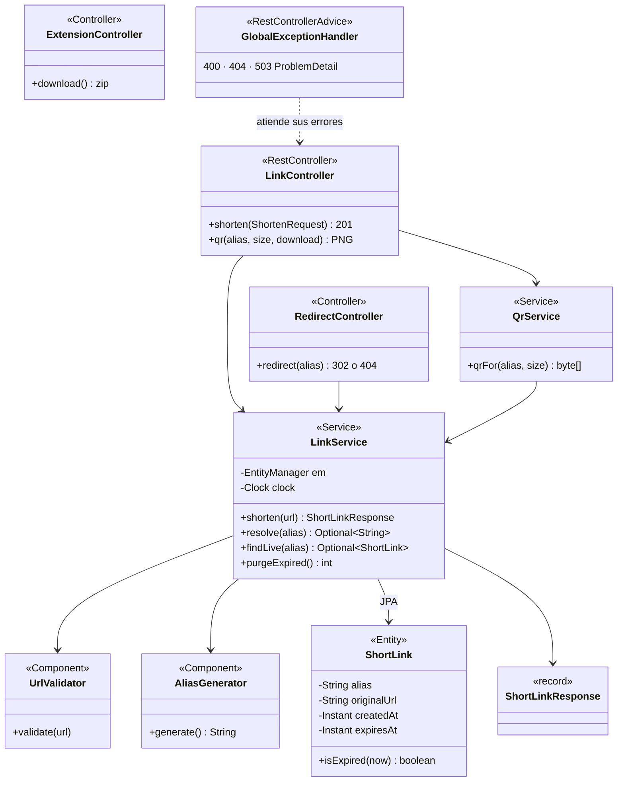

# PP6-TPGrupo2 – Acortador de enlaces (Link Shortener)

Trabajo Práctico Integrador – **Paradigmas de Programación VI** – Etapa 1
**Cátedra:** FIE – 5to Año – Ingeniería en Informática
**Equipo:** Martín Crespo · Sofía Ramirez · Agustín Gimenez

- Consigna: [`TP_PP6_v1.0.md`](TP_PP6_v1.0.md)
- Especificación, decisiones de diseño y plan de pruebas: [`contexto.md`](contexto.md)
- Cómo está hecho, clase por clase y con enlaces al código: https://paradigmas6.agustingimenez.ar/coloquio (con la app levantada, también en http://localhost:8080/coloquio)

## Qué hace

Pegás una dirección larga y obtenés un **enlace corto y su código QR, válidos por 60 minutos**. Después, el enlace responde "Este enlace expiró o no existe" y el alias puede volver a usarse.

Los alias son lo más cortos posible: `/1`, `/2`, …, `/9`, `/a`, …, `/z`, `/10`… Cada enlace nuevo recibe **el menor alias libre**, así que el de un enlace vencido se reutiliza antes de pasar a uno más largo.

Hay dos clientes: la **página web** y la **extensión para Chrome y Firefox**. Los dos usan la misma API.

| Endpoint | Qué hace |
| :--- | :--- |
| `POST /api/v1/links` con `{"url": "..."}` | Crea el enlace → `201` con `shortUrl`, `expiresAt`, `secondsRemaining` y `qrUrl`. `400` si la URL es inválida, `503` si no hay alias libres. Con `"reuseExisting": true` (lo usa la extensión), si la URL ya tiene un enlace vigente lo renueva 60 minutos y responde `200` |
| `GET /{alias}` | `302` a la URL original mientras está vigente; `404` (misma página) si venció o no existe |
| `GET /api/v1/links/{alias}/qr?size=256&download=false` | PNG del QR (128 a 1024 px). Con `download=true` se descarga como `{alias}.png` |

### Usuarios: tu propio espacio `/{usuario}/{alias}`

Con sesión iniciada, cada usuario crea enlaces con el alias que quiera dentro de su nombre, por ejemplo `https://paradigmas6.agustingimenez.ar/ana/facultad`. También duran 60 minutos.

- **Desde el celular:** "Ingresá" → "Ingresá con Google".
- **Desde la computadora:** "Ingresá" muestra un QR (como WhatsApp Web). Se escanea con el celular, se inicia sesión con Google allí, se toca **Confirmar** y la computadora entra sola. El código se renueva solo cada 60 segundos y el anterior deja de servir.
- La sesión de la computadora se cierra sola a los 30 minutos; dos minutos antes la página ofrece **Extender sesión**.
- En el primer ingreso se asigna un nombre aleatorio (`usuario-xxxxxxxx`) que **hay que reemplazar** por uno propio antes de crear enlaces: 3 a 20 letras minúsculas, números o guiones, único.
- `/{usuario}` es tu página: el acortador personal y el perfil. Si cambiás el nombre, tus enlaces pasan al nuevo y el anterior queda **reservado 10 minutos** para vos (podés volver a él). Mientras tanto, quien abra un enlace con el nombre anterior ve un aviso con la dirección nueva y sigue al destino; después el nombre anterior se libera y deja de funcionar.

| Endpoint | Qué hace |
| :--- | :--- |
| `GET /api/v1/me` | Datos de la cuenta (`401` sin sesión) |
| `PUT /api/v1/me/username` con `{"username": "..."}` | Elige o cambia el nombre. `400` si es inválido o reservado, `409` si está ocupado o si el anterior sigue reservado (solo se puede volver a él) |
| `POST /api/v1/me/links` con `{"url": "...", "alias": "..."}` | Crea `/{usuario}/{alias}` → `201` (sin alias, uno aleatorio). `409` si el alias está vigente o falta elegir el nombre. Con `"reuseExisting": true` renueva el enlace vigente a esa URL → `200` |
| `PATCH /api/v1/me/links/{alias}` con `{"alias": "..."}` | Cambia el alias de un enlace propio |
| `GET /api/v1/me/session`, `POST /api/v1/me/session/extend` | Vencimiento de la sesión de la computadora y extensión |
| `GET /{usuario}` | Página del usuario (acortador y perfil) |
| `GET /{usuario}/{alias}` | `302` mientras está vigente; `404` si venció o no existe. Con el nombre anterior todavía reservado, página de aviso con la dirección nueva |
| `GET /api/v1/users/{usuario}/links/{alias}/qr` | PNG del QR del enlace personal |
| `POST /api/v1/login-requests`, `GET /api/v1/login-requests/current` y `/current/qr` | Ingreso por QR de la computadora: pide el código, consulta el estado y muestra el QR |
| `POST /api/v1/login-requests/{código}/approve` | El celular, con sesión, aprueba el código → `204` |
| `POST /api/v1/logout` | Cierra la sesión |

Las peticiones que modifican algo con sesión llevan el token CSRF: la cookie `XSRF-TOKEN` se devuelve en el header `X-XSRF-TOKEN` (las páginas lo hacen solas). `POST /api/v1/links` no lo necesita.

## Compilar y ejecutar

Stack: **Java 25**, Spring Boot 4.1.1, JPA/Hibernate sobre HSQLDB, Gradle 9.8.1. El wrapper está incluido: no hace falta instalar Gradle. Si no hay un JDK 25 instalado, Gradle lo descarga solo la primera vez.

| Acción | Windows | Linux / macOS |
| :--- | :--- | :--- |
| Levantar la aplicación | `.\gradlew.bat bootRun` | `./gradlew bootRun` |
| Compilar y correr los tests | `.\gradlew.bat build` | `./gradlew build` |
| Tests + cobertura mínima | `.\gradlew.bat check` | `./gradlew check` |
| Generar el JAR | `.\gradlew.bat bootJar` | `./gradlew bootJar` |

Con la aplicación levantada:

- Página web: http://localhost:8080
- Documentación de la API (Swagger): http://localhost:8080/swagger-ui.html
- Guía del código (diagrama de clases, recorridos y decisiones): http://localhost:8080/coloquio

Los enlaces se guardan en HSQLDB en modo archivo (`./data/`, ignorado por git) y sobreviven a un reinicio.

`check` falla si la cobertura de líneas de `app.mappings` + `app.service` baja del 70 %. El reporte queda en `build/reports/jacoco/test/html/index.html`.

El JAR queda en `build/libs/shortener.jar` y necesita Java 25 para ejecutarse. Toda la configuración está en `src/main/resources/application.properties`. Para correr en otra máquina solo cambia el dominio con el que se arman los enlaces, con una variable de entorno (ver `.env.example`):

```bash
APP_BASE_URL=http://ip-o-dominio:8080 java -jar shortener.jar
```

### Ingreso con Google

Sin credenciales todo lo público funciona, pero el ingreso no. Para habilitarlo:

1. En [Google Cloud Console](https://console.cloud.google.com/apis/credentials) crear un **ID de cliente de OAuth** de tipo "Aplicación web".
2. Agregar como URI de redireccionamiento autorizado `{APP_BASE_URL}/login/oauth2/code/google` (por ejemplo `https://paradigmas6.agustingimenez.ar/login/oauth2/code/google`, y `http://localhost:8080/login/oauth2/code/google` para probar en local).
3. Pasar el ID y el secreto **como variables de entorno**, nunca en el repositorio:

```bash
GOOGLE_CLIENT_ID=... GOOGLE_CLIENT_SECRET=... APP_BASE_URL=https://paradigmas6.agustingimenez.ar \
SERVER_FORWARD_HEADERS_STRATEGY=native HQL_CONSOLE_ENABLED=false java -jar shortener.jar
```

En el VPS la aplicación va detrás de un proxy con HTTPS (Google lo exige fuera de `localhost`). `SERVER_FORWARD_HEADERS_STRATEGY=native` hace que respete los headers `X-Forwarded-*` del proxy, y `HQL_CONSOLE_ENABLED=false` apaga la consola JPQL, que permite leer y modificar toda la base. Para el QR de la computadora, el celular tiene que poder abrir `APP_BASE_URL`: en local, usar la IP de la máquina en lugar de `localhost`.

## Extensión para Chrome y Firefox

La carpeta [`browser-extension/`](browser-extension/) es la extensión (Manifest V3, el mismo código para los dos navegadores). Al tocar su ícono (un eslabón de cadena) **acorta la pestaña activa sin más pasos** y muestra el enlace, el QR, los botones para copiar y descargar el QR, y la fecha y hora de vencimiento. Si la página ya estaba acortada, muestra el mismo enlace y renueva su vigencia por 60 minutos. Si la pestaña ya es un enlace corto del acortador, no lo vuelve a acortar. Si en ese navegador iniciaste sesión en el acortador y elegiste tu nombre, el enlace queda a tu nombre (`/{usuario}/{alias}`); si no, es público.

Usa el servidor indicado en `config.js`, que es `http://localhost:8080`: **la aplicación tiene que estar levantada**.

**Chrome / Edge**
1. Abrir `chrome://extensions` (en Edge, `edge://extensions`).
2. Activar **Modo de desarrollador** (arriba a la derecha).
3. **Cargar descomprimida** → elegir la carpeta `browser-extension`.
4. Fijar la extensión con el ícono del rompecabezas, para tenerla a mano.

**Firefox**
1. Abrir `about:debugging#/runtime/this-firefox`.
2. **Cargar complemento temporal…** → elegir `browser-extension/manifest.json` (o el `.zip`).
3. Firefox la quita al cerrarse: es una carga temporal porque la extensión no está firmada.

En páginas que no son http/https (por ejemplo `chrome://extensions` o una pestaña nueva) muestra el aviso "Esta página no se puede acortar (solo http/https)".

Con la aplicación levantada, la página web ofrece el `.zip` en **Descargar la extensión**, ya configurado para llamar al servidor del que se bajó. Para generarlo sin levantar la app, en `build/extension/acortador-pp6.zip`:

```powershell
.\gradlew.bat extensionZip
```

Los íconos (`browser-extension/icons/`, 16 a 128 px) se regeneran con `scripts\generate-extension-icons.ps1`.

## Estructura del código

Sigue la estructura del proyecto de referencia de la cátedra (`contexto.md` §8).

```text
src/main/java/app
├── Application.java   arranque, reloj, CORS para la extensión, tarea programada
├── SecurityConfig.java  sesión, login con Google y CSRF
├── controller/        endpoints REST, redirección y páginas
├── dto/               entrada y salida JSON
├── service/           reglas de negocio y consultas JPQL
├── mappings/          entidades JPA (ShortLink, AppUser, PersonalLink, LoginRequest)
└── exception/         errores de negocio y su respuesta HTTP

src/main/resources/static/   página web (HTML, CSS y JS sin framework)
src/test/java/app/           tests unitarios y de integración
browser-extension/           extensión para Chrome y Firefox
```

Las flechas van de quien usa a quien es usado. La versión interactiva, con la explicación de cada clase y botones al código, está en `/coloquio`.


